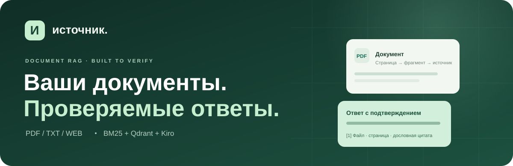
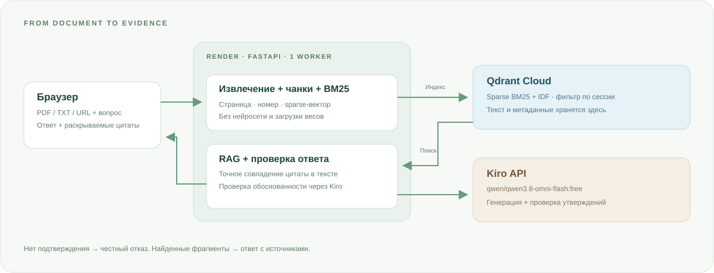

<p align="center">
  
</p>

<h1 align="center">Источник</h1>
<p align="center">
  Чат с документами, который показывает, откуда взял ответ.<br>
  PDF, TXT и страницы сайта. Источники, цитаты и честный отказ вместо догадок.
</p>

<p align="center">
  <a href="https://rag-system-5gdz.onrender.com/"><strong>Открыть сайт ↗</strong></a>
  &nbsp; · &nbsp;
  <a href="docs/DEPLOYMENT.md">Развернуть свою версию</a>
  &nbsp; · &nbsp;
  <a href="docs/ARCHITECTURE.md">Как это устроено</a>
</p>

<p align="center">
  <a href="https://github.com/inpeacedTeams/rag-system/actions/workflows/ci.yml"></a>
  
  
  
  
</p>

> **Демо:** https://rag-system-5gdz.onrender.com/  
> На Render Free первый запрос после простоя может открываться дольше из-за пробуждения сервиса. Для работы с вашими материалами загрузите собственный документ.

## Навигация

[Возможности](#возможности) · [Архитектура](#архитектура) · [Быстрый старт](#быстрый-старт) · [Render Free](#деплой-на-render-free) · [Структура](#структура-репозитория) · [Документация](#документация)

## Что это за проект

**Источник** превращает загруженные материалы в небольшую базу знаний. Пользователь задаёт вопрос, приложение находит подходящие фрагменты и просит модель ответить только по ним. Ответ сопровождается точными цитатами, именем файла, страницей PDF и номером чанка.

Если подтверждения нет, приложение не подменяет документы общими знаниями:

> В загруженных документах нет этой информации

Текущая версия использует **BM25, то есть лексический поиск, а не нейросетевые эмбеддинги**. Это осознанный компромисс для Render Free с 512 МБ RAM: без загрузки весов, FastEmbed, ONNX и дополнительных ключей для эмбеддингов. Поиск лучше работает, когда вопрос содержит термины из документа.

## Возможности

| | Что доступно |
| :--- | :--- |
| **Документы** | Загрузка текстовых PDF и TXT, выбор нескольких файлов и drag-and-drop |
| **Сайты** | Импорт текста одной публичной страницы по HTTP/HTTPS-ссылке |
| **Поиск** | Чанки, нормализация слов, sparse BM25-векторы и IDF в Qdrant |
| **Ответы** | Kiro получает только вопрос и найденные фрагменты |
| **Источники** | Имя файла, страница PDF, номер чанка и раскрываемая дословная цитата |
| **Проверка** | Совпадение цитаты проверяется кодом, обоснованность дополнительно проверяется моделью |
| **Управление** | Удаление отдельного документа и очистка своей базы с подтверждением |
| **Интерфейс** | Русский язык, адаптивная вёрстка, индикаторы обработки и сообщения об ошибках |
| **Изоляция** | Материалы разных браузерных сессий разделены серверным фильтром |

## Архитектура

<p align="center">
  
</p>

**Загрузка:** извлечённый текст разбивается на фрагменты с сохранением страниц и метаданных. Лёгкий BM25-кодировщик создаёт разреженные векторы, после чего Qdrant сохраняет их вместе с текстом.

**Вопрос:** Qdrant возвращает до восьми фрагментов только из текущей сессии. Kiro формирует утверждения с цитатами. Backend проверяет источник и дословное совпадение цитаты; второй запрос модели проверяет обоснованность. Пользователь получает ответ с источниками или отказ.

| Компонент | Технология | Роль |
| :--- | :--- | :--- |
| Интерфейс | HTML, CSS, JavaScript | Загрузка материалов и чат без отдельной frontend-сборки |
| Backend | Python 3.12, FastAPI | API, обработка документов, сессии и проверки |
| Поиск | Собственный BM25-кодировщик | Лексические sparse-векторы без нейросети |
| Хранилище | Qdrant / Qdrant Cloud | Индекс, IDF, текст, метаданные и фильтрация |
| Ответы | Kiro, OpenAI-compatible API | `qwen/qwen3.8-omni-flash:free` |
| Деплой | Docker, Render | Один web-процесс, порт из `PORT` |

Подробные схемы потоков и технические решения: **[Архитектура](docs/ARCHITECTURE.md)**.

## Быстрый старт

Понадобятся Docker с Compose v2 и ключ Kiro. Локальный Compose автоматически поднимает Qdrant, поэтому облачный кластер для локального запуска не обязателен.

````bash
git clone https://github.com/inpeacedTeams/rag-system.git
cd rag-system
cp .env.example .env
python3 -c "import secrets; print(secrets.token_hex(32))"
````

В `.env` укажите свой `KIRO_API_KEY` и вставьте результат последней команды в `SESSION_SECRET`. Не публикуйте ключи и не добавляйте `.env` в Git.

````bash
docker compose up --build -d
````

Откройте **http://localhost:8000**. Загрузите документ, дождитесь индексации и задайте вопрос.

<details>
<summary><strong>Полезные команды</strong></summary>

````bash
docker compose logs -f app
docker compose down
docker compose up --build -d --force-recreate app
````

`docker compose down` сохраняет базу. Команда `docker compose down -v` необратимо удаляет локальную базу всех сессий.

</details>

## Деплой на Render Free

Создайте **Docker Web Service** из `main`. Root Directory и Docker Command оставьте пустыми, Dockerfile Path задайте `./Dockerfile`, Health Check Path задайте `/health`. Подключите внешний кластер Qdrant Cloud: Render не запускает соседний сервис из `compose.yaml` автоматически.

Минимальные переменные Environment:

````dotenv
KIRO_API_KEY=YOUR_KIRO_KEY
SESSION_SECRET=YOUR_RANDOM_SECRET
CHAT_BASE_URL=https://api.xkiro.com/v1
CHAT_MODEL=qwen/qwen3.8-omni-flash:free
QDRANT_URL=https://YOUR_CLUSTER.cloud.qdrant.io
QDRANT_API_KEY=YOUR_QDRANT_KEY
QDRANT_COLLECTION=documents_bm25_v1
MIN_RELEVANCE_SCORE=0
COOKIE_SECURE=true
````

После сохранения нажмите **Manual Deploy → Deploy latest commit**. Dockerfile использует `PORT`, который задаёт Render, а локально без него слушает 8000.

Полная инструкция, миграция со старой версии и разбор ошибок: **[Деплой](docs/DEPLOYMENT.md)**.

## Как попробовать

Создайте TXT в UTF-8 с текстом:

> Срок оплаты по договору составляет десять рабочих дней.

Загрузите его и спросите **«Какой срок оплаты по договору?»**. В ответе проверьте цитату и номер чанка. Затем спросите **«Какой курс доллара сегодня?»**: если такой информации в материалах нет, приложение должно отказать.

Для BM25 вопрос **«Какой порядок оплаты?»** предпочтительнее перефразирования **«Как перечислить деньги?»**, если документ использует слова «порядок оплаты». Совпадение по смыслу без общих терминов не гарантируется.

## Ограничения, о которых важно знать

По умолчанию допускаются **5 МБ на файл, 100 страниц PDF, 1000 чанков на документ и 30 документов на сессию**. Сканированным PDF нужен предварительный OCR; PDF с паролем не принимаются. По ссылке импортируется одна страница без исполнения JavaScript, а не весь сайт.

Проверки уменьшают риск галлюцинаций, но не дают математической гарантии правильности. Отказ означает отсутствие подтверждения среди найденных фрагментов, а не доказанное отсутствие ответа во всей базе. Важные выводы сверяйте с цитатами.

Сессия привязана к cookie браузера, это не система пользовательских аккаунтов. При очистке cookie доступ к прежней базе теряется. История чата живёт в текущей вкладке и не используется для понимания последующих вопросов. Политики хранения, передачи данных и защиты описаны в **[Безопасности](docs/SECURITY.md)**.

Render Free и модели с суффиксом `:free` имеют квоты. Отсутствие нейросети снижает потребление памяти, но не гарантирует обработку произвольных тяжёлых PDF на 512 МБ RAM.

## Структура репозитория

````text
rag-system/
├── app/
│   ├── main.py                 API, сессии и ограничения
│   ├── config.py               Настройки окружения
│   ├── documents.py            PDF/TXT и разбиение на чанки
│   ├── web.py                  Безопасный импорт страниц
│   ├── embeddings.py           Лёгкие BM25-векторы
│   ├── store.py                Работа с Qdrant
│   ├── providers.py            Клиент Kiro и проверка ответов
│   ├── rag.py                  Проверка цитат и источников
│   └── static/                 Интерфейс сайта
├── docs/
│   ├── ARCHITECTURE.md          Архитектура и потоки данных
│   ├── DEPLOYMENT.md            Запуск, Render и диагностика
│   ├── SECURITY.md              Защита и передача данных
│   ├── API.md                   Маршруты, примеры и настройки
│   └── assets/                 Графика README
├── tests/                      Unit, API и Qdrant-тесты
├── .github/workflows/ci.yml     Тесты и Docker build
├── Dockerfile
├── compose.yaml
└── .env.example
````

## Проверки

````bash
python3 -m venv .venv
. .venv/bin/activate
pip install -r requirements-dev.txt
python -m unittest discover -s tests -v
node --check app/static/app.js
````

GitHub Actions проверяет обработку документов, цитаты, BM25, безопасность URL, HTTP-маршруты, сессии и выбор порта. Затем поднимает настоящий Qdrant для проверки sparse-записи, поиска и изоляции удаления и собирает Docker image.

Unit-тесты не выполняют реальные запросы Kiro. Интеграционный тест Qdrant локально пропускается без `QDRANT_TEST_URL`; успешные unit-тесты не доказывают качество ответов модели или доступность пользовательских API-ключей.

## Документация

| Документ | Что внутри |
| :--- | :--- |
| [Архитектура](docs/ARCHITECTURE.md) | Схемы индексации и ответа, sparse-поиск, устройство сессий |
| [Деплой](docs/DEPLOYMENT.md) | Docker, Render Free, Qdrant Cloud, миграция и типовые ошибки |
| [API и конфигурация](docs/API.md) | Переменные окружения, маршруты, примеры запросов и ответов |
| [Безопасность](docs/SECURITY.md) | API-ключи, SSRF, cookie, внешние провайдеры и ограничения |

<p align="center">
  <strong>Меньше поиска. Больше ясности.</strong><br>
  <a href="https://rag-system-5gdz.onrender.com/">Попробовать Источник ↗</a>
</p>
